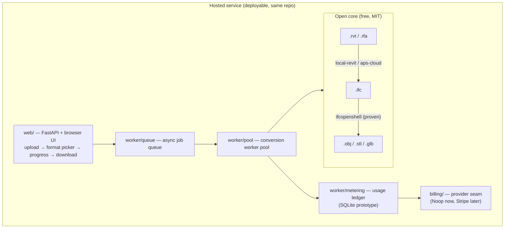

# RevitBridge

Open-source toolkit for converting between Autodesk Revit files (`.rvt`/`.rfa`) and open 3D formats (IFC, GLB/glTF, OBJ, STL). MIT licensed — take it, share it, modify it, improve it.

**One rule governs this repo: never claim a conversion you can't demonstrate.** Every capability below is tagged with what backs it. Anything that needs a Windows machine with Revit, or APS credentials, is marked as such — the code is there, the proof isn't, and we say so.

## Capability matrix

| # | Conversion | Backend | Status | Evidence |
|---|---|---|---|---|
| 1 | IFC → OBJ | `ifcopenshell` | ✅ Proven | 40 verts / 60 faces / 5 materials on the synthetic fixture; CI |
| 2 | IFC → STL | `ifcopenshell` | ✅ Proven | 60 facets, valid ASCII STL; CI |
| 3 | IFC → GLB | `ifcopenshell` | ✅ Proven | Reloads in trimesh, 5 geometries, correct bounds; CI |
| 4 | RVT metadata probe | `rvt_probe` | ✅ Proven | Real Autodesk sample (`racbasicsamplefamily-2024.rfa`): version, build, 13 streams, PNG preview, 10,973 schema classes |
| 5 | RVT → IFC | `local-revit` | 🛠 Scaffolded | Full orchestration code (Revit API `Document.Export` + `IFCExportOptions`, export bundle generator). **Needs Windows + Revit to prove.** |
| 6 | RVT → IFC | `aps-cloud` | 🛠 Scaffolded | Full Design Automation v3 REST flow. **Needs APS app credentials + a DA activity.** |
| 7 | RVT → GLB/OBJ/STL | via IFC | 🛠 Scaffolded end-to-end | Hop 2 (rows 1–3) proven; hop 1 needs row 5 or 6 proven first |
| 8 | IFC/OBJ/GLB → RVT | `local-revit` | 🛠 Scaffolded, limited | DirectShape import by design = **dumb geometry, no parametric round-trip**. Honest on purpose — see "The hard direction" |
| 9 | IFC → glTF JSON (`.gltf`) | `ifcopenshell` | 🛠 Scaffolded | Use `.glb` (byte-equivalent geometry) until the JSON writer lands |
| 10 | anything → STEP | — | ❌ Not feasible (v1) | Our pipeline tessellates to triangles; triangles are not a STEP boundary-rep. True STEP needs OpenCASCADE B-rep reconstruction — roadmap |

**What round-trips?** Nothing with full fidelity, and we won't pretend otherwise. RVT → IFC → mesh is lossy (tessellation discards parametrics and most metadata). Mesh → RVT is dumb solid geometry. IFC is the hub because it's the only open format in the chain.

## Architecture

Two layers, one repo. The converter core is free forever; the hosted service
sells machine time on top of it.



Every conversion runs through the open core. Every job records metered
machine seconds into the usage ledger — that metering is the billing
foundation (see [`docs/cost-model.md`](docs/cost-model.md)).

## Hosted service

```
web/       FastAPI app + single-page frontend (no build step)
worker/    job queue, worker pool, metering ledger
billing/   rate card + billing provider seam
```

```bash
pip install -e ".[web]"
uvicorn web.app:app --host 0.0.0.0 --port 8000
# open http://localhost:8000 — upload a file, pick a format, download the result
```

API: `POST /api/jobs` (multipart: `file`, `to`, optional `backend`) → `202 {job_id}`;
`GET /api/jobs/{id}` (status/progress/metered_seconds/cost_usd);
`GET /api/jobs/{id}/download`. Optional API-key auth via `RB_API_KEY`.

Prototype limits, stated plainly: in-memory queue (lost on restart — swap
`worker/queue.py:JobQueue` for Redis/RQ), SQLite ledger (swap for Postgres),
single-machine workers, no user accounts yet (`user_id="anonymous"`), Noop
billing. Each seam is an ABC with the production swap documented at its
definition site.

## Business model

**The software is free. Machine time is the product.**

- Free tier: 15 conversion-minutes/month, no card — enough to convert a real
  project and fall in love with the tool.
- Paid: metered per conversion-minute per the rate card (`billing/rates.py`).
  IFC jobs cost us fractions of a cent; RVT jobs via APS cost ~$0.10/min.
- Billing is designed for Stripe metered billing (meter events off the usage
  ledger) but not wired — `billing/provider.py:StripeBillingProvider` is a
  documented seam with a wire-up checklist.

The full unit economics — our cost per backend, worked examples, what breaks
the model (Revit headless licensing is the big unknown) — live in
[`docs/cost-model.md`](docs/cost-model.md). That doc is the business core;
keep it current.

## Quickstart

```bash
pip install revit-bridge   # (or: pip install -e . from source)

# Inspect any Revit file without Revit installed (static only)
revit-convert model.rvt --probe

# Convert IFC -> mesh (works everywhere, proven)
revit-convert model.ifc --to glb
revit-convert model.ifc --to obj --out out/model.obj
revit-convert model.ifc --to stl

# RVT paths need a backend that can actually read RVT:
revit-convert model.rvt --to glb --backend local-revit   # Windows + Revit
revit-convert model.rvt --to ifc --backend aps-cloud     # APS credentials in env
revit-convert model.rvt --to glb --backend mock          # pipeline smoke test only

revit-convert --list-backends   # what each backend does + its honesty status
```

## Backends

| Backend | Runs where | Does | Secrets |
|---|---|---|---|
| `ifcopenshell` | anywhere | IFC → OBJ/STL/GLB | none |
| `local-revit` | Windows + Revit | RVT → IFC (Revit API); X → RVT (DirectShape) | none |
| `aps-cloud` | anywhere | RVT → IFC via APS Design Automation | `APS_CLIENT_ID`, `APS_CLIENT_SECRET`, `APS_ACTIVITY_ID`, signed URLs — env only, never in the repo |
| `mock` | anywhere | pipeline test double (writes a manifest, converts nothing) | none |

`revit-convert` picks sensible defaults per hop; `--backend` overrides (it must support every hop).

## The RVT probe: what reverse engineering actually got us

We applied a static-only RE workflow (see `docs/re/`) to the RVT container instead of pretending the format is parseable. Verified against a real Autodesk-distributed sample file:

- **Container**: OLE2 Compound Document (public MS-CFB) — `olefile` opens it, 13 streams enumerable.
- **Compression**: truncated gzip (10-byte header + raw DEFLATE); `Global/*` streams add an 8-byte framing header.
- **Reads that work**: `BasicFileInfo` → version/build/original path (UTF-16LE); `RevitPreview4.0` → PNG thumbnail (strip the `62 19 22 05` wrapper); `PartAtom` → family XML; `Formats/Latest` → the embedded class schema (10,973 classes in the 2024 sample).
- **Does NOT work**: element geometry. The `Partitions/*` wire envelope is unverified, and every public RE effort agrees the last mile isn't there yet. The probe says this on every run.

Prior art we built on: [phi-ag/rvt](https://github.com/phi-ag/rvt) (metadata + thumbnails), [rvt-rs](https://github.com/DrunkOnJava/rvt-rs) (deepest public RE writeup), Autodesk's [revit-ifc](https://github.com/Autodesk/revit-ifc) (the real exporter, runs inside Revit).

## The hard direction (X → Revit)

Importing geometry *into* Revit only works through the Revit API, and the only sane primitive is `DirectShape`: you get visible solids, not editable parametric families. Walls won't be walls; they'll be gray blobs with the right shape. Anyone promising "round-trip OBJ → RVT" without saying this is overselling. Our `local-revit` backend generates the import scaffolding and refuses to pretend it's more.

## Roadmap

Converter core: `.gltf` JSON writer, STEP via OpenCASCADE (the honest hard one),
`Partitions/*` wire-format RE (the grand prize), Windows CI leg proving
`local-revit` against real Revit.

Hosted service: Redis-backed queue, Postgres ledger, user accounts + API keys,
Stripe metered billing wired, worker autoscaling (Windows/Revit pool + APS
burst), abuse controls on the free tier.

## Contributing

Crowdsourced enhancement welcome — that's the point of MIT. Good first issues:

- `.gltf` JSON writer (trimesh export path)
- STEP via OpenCASCADE B-rep reconstruction (the honest hard one)
- `Partitions/*` wire-format RE — the grand prize; see `docs/re/` for the byte evidence so far
- Real-file corpus tests (bring your own licensed samples; never commit them)
- Windows CI leg that proves `local-revit` against an actual Revit install

Rules: no secrets in the repo, no copyrighted models in fixtures (all fixtures are synthesized), every new conversion claim needs a test that demonstrates it.

## License

MIT — see [LICENSE](LICENSE). Anyone can use, share, modify, and build on this.
