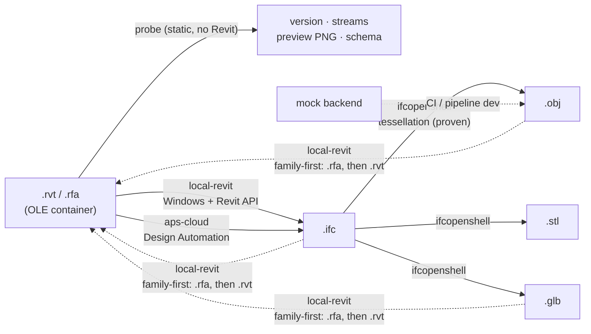

# RevitBridge

Open-source toolkit for converting between Autodesk Revit files (`.rvt`/`.rfa`) and open 3D formats (IFC, GLB/glTF, OBJ, STL). MIT licensed — take it, share it, modify it, improve it.

**One rule governs this repo: never claim a conversion you can't demonstrate.** Every capability below is tagged with what backs it. Anything that needs a Windows machine with Revit, or APS credentials, is marked as such — the code is there, the proof isn't, and we say so.

## Capability matrix

| # | Conversion | Backend | Status | Evidence |
|---|---|---|---|---|
| 1 | IFC → OBJ | `ifcopenshell` | ✅ Proven | 40 verts / 60 faces / 5 materials on the synthetic fixture; CI |
| 2 | IFC → STL | `ifcopenshell` | ✅ Proven | 60 facets, valid ASCII STL; CI |
| 3 | IFC → GLB | `ifcopenshell` | ✅ Proven | Reloads in trimesh, 5 geometries, correct bounds; CI |
| 4 | RVT metadata probe | `rvt_probe` | ✅ Proven | Real Autodesk sample (`racbasicsamplefamily-2024.rfa`): version, build, 13 streams, PNG preview, 10,973 schema classes |
| 5 | RVT → IFC | `local-revit` | 🛠 Scaffolded | Full orchestration code (Revit API `Document.Export` + `IFCExportOptions`, export bundle generator). **Needs Windows + Revit to prove.** |
| 6 | RVT → IFC | `aps-cloud` | 🛠 Scaffolded | Full Design Automation v3 REST flow. **Needs APS app credentials + a DA activity.** |
| 7 | RVT → GLB/OBJ/STL | via IFC | 🛠 Scaffolded end-to-end | Hop 2 (rows 1–3) proven; hop 1 needs row 5 or 6 proven first |
| 8 | OBJ/GLB/IFC → RFA (Revit family) | `local-revit` | 🛠 Scaffolded | **First X→Revit application.** Family doc from template + `TessellatedShapeBuilder` solid → `.rfa`. Dumb geometry by design, no parametrics |
| 9 | IFC/OBJ/GLB → RVT (project) | `local-revit` | 🛠 Scaffolded, secondary | DirectShape import; same dumb-geometry limits. Families first, projects later |
| 10 | IFC → glTF JSON (`.gltf`) | `ifcopenshell` | ✅ Proven | Hand-rolled glTF 2.0 writer (embedded buffer, per-mesh PBR materials); structure-validated + trimesh round-trip; CI |
| 11 | anything → STEP | — | ❌ Not feasible (v1) | Our pipeline tessellates to triangles; triangles are not a STEP boundary-rep. True STEP needs OpenCASCADE B-rep reconstruction — roadmap |

**What round-trips?** Nothing with full fidelity, and we won't pretend otherwise. RVT → IFC → mesh is lossy (tessellation discards parametrics and most metadata). Mesh → RVT is dumb solid geometry. IFC is the hub because it's the only open format in the chain.

## Architecture

IFC is the hub. Every RVT-out path goes RVT → IFC first; every mesh-out path
goes through IfcOpenShell tessellation.



This repo is the free converter core: library + CLI + format backends. No
billing, no pricing, no infra, no customer code — the hosted conversion
service lives in a separate private repo and consumes this package as a
dependency (never a fork).

## Quickstart

```bash
pip install revit-bridge   # (or: pip install -e . from source)

# Inspect any Revit file without Revit installed (static only)
revit-convert model.rvt --probe

# Convert IFC -> mesh (works everywhere, proven)
revit-convert model.ifc --to glb
revit-convert model.ifc --to obj --out out/model.obj
revit-convert model.ifc --to stl

# RVT paths need a backend that can actually read RVT:
revit-convert model.rvt --to glb --backend local-revit   # Windows + Revit
revit-convert model.rvt --to ifc --backend aps-cloud     # APS credentials in env
revit-convert model.rvt --to glb --backend mock          # pipeline smoke test only

revit-convert --list-backends   # what each backend does + its honesty status
```

## Backends

| Backend | Runs where | Does | Secrets |
|---|---|---|---|
| `ifcopenshell` | anywhere | IFC → OBJ/STL/GLB | none |
| `local-revit` | Windows + Revit | RVT → IFC (Revit API); X → RFA family first, X → RVT secondary | none |
| `aps-cloud` | anywhere | RVT → IFC via APS Design Automation | `APS_CLIENT_ID`, `APS_CLIENT_SECRET`, `APS_ACTIVITY_ID`, signed URLs — env only, never in the repo |
| `mock` | anywhere | pipeline test double (writes a manifest, converts nothing) | none |

`revit-convert` picks sensible defaults per hop; `--backend` overrides (it must support every hop).

## The RVT probe: what reverse engineering actually got us

We applied a static-only RE workflow (see `docs/re/`) to the RVT container instead of pretending the format is parseable. Verified against a real Autodesk-distributed sample file:

- **Container**: OLE2 Compound Document (public MS-CFB) — `olefile` opens it, 13 streams enumerable.
- **Compression**: truncated gzip (10-byte header + raw DEFLATE); `Global/*` streams add an 8-byte framing header.
- **Reads that work**: `BasicFileInfo` → version/build/original path (UTF-16LE); `RevitPreview4.0` → PNG thumbnail (strip the `62 19 22 05` wrapper); `PartAtom` → family XML; `Formats/Latest` → the embedded class schema (10,973 classes in the 2024 sample).
- **Does NOT work**: element geometry. The `Partitions/*` wire envelope is unverified, and every public RE effort agrees the last mile isn't there yet. The probe says this on every run.

Prior art we built on: [phi-ag/rvt](https://github.com/phi-ag/rvt) (metadata + thumbnails), [rvt-rs](https://github.com/DrunkOnJava/rvt-rs) (deepest public RE writeup), Autodesk's [revit-ifc](https://github.com/Autodesk/revit-ifc) (the real exporter, runs inside Revit).

## The hard direction (X → Revit), family-first

Importing geometry *into* Revit only works through the Revit API, and the
first application is **Revit families** (`.rfa`) — not full project documents.
Families are the reusable component unit (a chair, a pump, a light fixture),
and a family import is a smaller, faster, cheaper job than a whole project:
the ideal wedge for the hosted service.

The honest mechanism: a new family document from a template
(`Application.NewFamilyDocument`), mesh → solid via `TessellatedShapeBuilder`,
placed with `FreeFormElement`, saved as `.rfa`. What you get is visible,
schedulable solid geometry — not editable parametric families. It'll be the
right shape with no parameters. Anyone promising "round-trip OBJ → RVT"
without saying this is overselling. Full-project import stays secondary until
family import is proven on a real Revit machine — that's the next milestone.

## Roadmap

**Prove X→RFA family import on Windows+Revit** (wire `ReadTriangles`, run the
generated bundle — the current milestone), STEP via OpenCASCADE (the honest
hard one), `Partitions/*` wire-format RE (the grand prize), Windows CI leg
proving `local-revit` against real Revit.

## Contributing

Crowdsourced enhancement welcome — that's the point of MIT. Good first issues:

- STEP via OpenCASCADE B-rep reconstruction (the honest hard one)
- `Partitions/*` wire-format RE — the grand prize; see `docs/re/` for the byte evidence so far
- Real-file corpus tests (bring your own licensed samples; never commit them)
- Windows CI leg that proves `local-revit` against an actual Revit install

Rules: no secrets in the repo, no copyrighted models in fixtures (all fixtures are synthesized), every new conversion claim needs a test that demonstrates it.

## License

MIT — see [LICENSE](LICENSE). Anyone can use, share, modify, and build on this.
